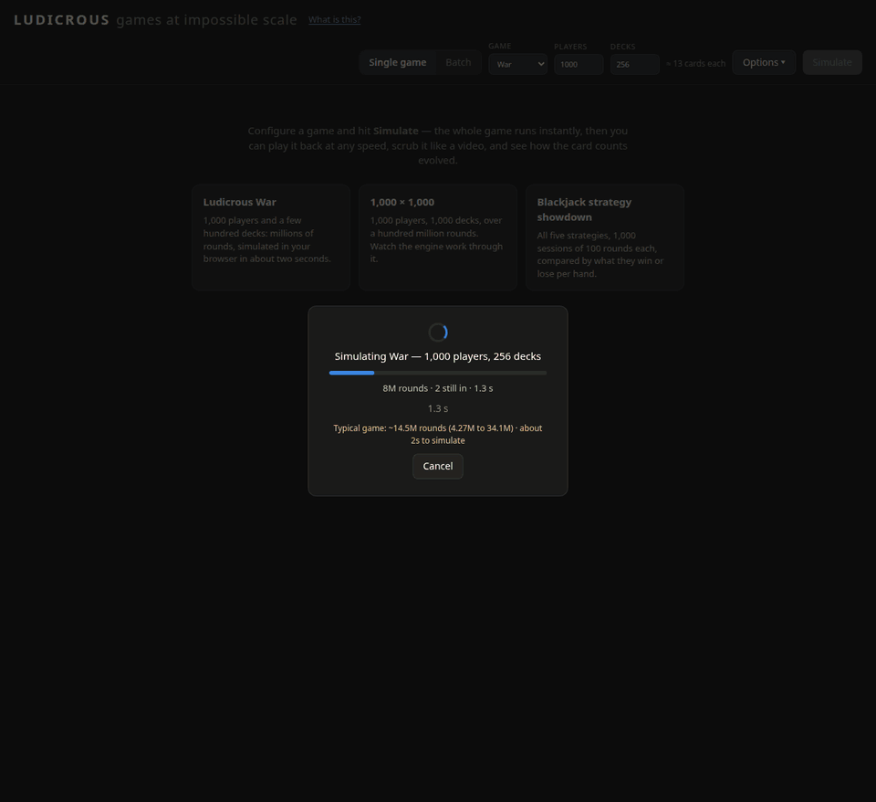

# Ludicrous

[](https://github.com/CodeManEthan/ludicrous/actions/workflows/ci.yml)

**[Live demo](https://ludicrous-production-6bdb.up.railway.app)**



*What the demo plays when you open it: War with 1,000 players on 256 decks, 14.5 million
rounds, simulated in the browser and played back. Recorded in headless Chromium; the
capture slowed the simulation from about 1 s to 2 s.*

Games at impossible scale. Take a game meant for a kitchen table, like War or
Blackjack, and expand it far past anything you could play for real: 1,000 players,
1,000 decks, a hundred million rounds, thousands of games in parallel. Simulate the
whole thing in seconds, then play it back in the browser at any speed. Scrub it like a
video, watch rounds unfold card by card, and chart how the game went.

The name is the point. *Ludicrous* descends from Latin *ludus*, game, so it means both
"of games" and "absurdly extreme." Both senses apply.

## Architecture

Two engines play War, one in Python and one in Rust. Blackjack is Python only.

**The Python engine (`engine/`) is the reference.** It has no dependencies and no UI
imports, and it is deterministic under a seed. It defines the rules of both games and the
recording format (an event log any frontend can replay; see
[docs/ENGINE.md](docs/ENGINE.md) and [docs/EVENT_SCHEMA.md](docs/EVENT_SCHEMA.md)). It
runs every Blackjack game and batch and the command-line simulator. It also plays War on
the server, up to 200 players and 200 decks, for old links and for browsers without
WebAssembly, and runs War batches when the native runner is missing.

**The Rust core (`core-rs/`) runs War at full scale.** It is built twice:

- To WebAssembly for the browser (`web/core/`). `web/war-worker.js` runs it in a
  background worker. The worker simulates the whole game once and keeps checkpoints along
  the way; any round is rebuilt from the nearest checkpoint, so seeking anywhere in a
  hundred-million-round game is instant. No event log ever reaches the page.
- To a static Linux binary, `bin/lud-batch`, which `server.py` runs for War batches. It
  spreads the games across every CPU core and streams progress back to the page.

Both builds are committed, so `python3 server.py` needs no Rust toolchain.

The Rust core shuffles with xoshiro256\*\*, the Python engine with CPython's Mersenne
Twister, so the same seed gives a different game on each. Links mark Rust games with
`engine=v2`.

**How the two engines are kept in agreement.** The Rust tests carry a test-only port of
CPython's Mersenne Twister (`core-rs/crates/ludicrous-core/src/mt19937.rs`). With it
plugged in, the Rust engine must replay the Python engine's games field by field, against
fixtures written by `core-rs/oracle/gen_oracle.py`, and must write the same event JSON
byte for byte. Golden recordings in `tests/golden/` freeze the Python recording format;
golden vectors check the Rust random source against an independent Python
implementation.

**Speeds**, measured on a 16-thread laptop (Intel i7-13620H):

| Engine | Where | War rounds per second |
|---|---|---|
| Python | one core, recording every event | about 45k to 100k |
| Python | one core, batch mode (no event log) | about 70k to 170k |
| Rust, WebAssembly | Chromium | about 10M to 16M |
| Rust, native | one thread | 25M to 37M |

The Python figures span games of 6 to 200 players. The browser figure comes from a
200-player, 200-deck game (7.07M rounds in 0.69 s) and the arrival game (14.5M rounds in
0.91 s, headless). [docs/DESIGN.md](docs/DESIGN.md), the design log behind the Rust
core, has the Rust measurements in full.

**Rebuilding the Rust artifacts.** `core-rs/build-wasm.sh` rebuilds the WebAssembly
bundle in `web/core/`, and `core-rs/build-native.sh` rebuilds `bin/lud-batch`. Both need
rustc 1.98.0 with the `wasm32-unknown-unknown` and `x86_64-unknown-linux-musl` targets;
if those are missing, the scripts print the `rustup` command that installs them. The
wasm script installs its own locked copy of wasm-bindgen 0.2.127 under `core-rs/target/`.
The builds are reproducible: `core-rs/check-artifacts.sh` rebuilds all three files and
fails unless they match the committed ones byte for byte. CI runs it on every push to
`main`.

## Features

- **Two games.** War (2 to 1,000 players, 1 to 1,000 decks) and Blackjack (up to 200
  seats against the dealer; dealer stands on soft 17, blackjack pays 3:2, doubling and
  pair splitting).
- **Something to watch on arrival.** The bare URL plays a 1,000-player War game on 256
  decks (seed 10, 14.5 million rounds) straight away. Three presets sit under the header:
  Ludicrous War, 1,000 × 1,000 (130 million rounds, about 8 s to simulate in Chromium on the laptop above), and a
  Blackjack strategy showdown.
- **The whole game is simulated first.** War runs in the browser on the Rust core. A
  progress screen shows the rounds so far, a bar against a typical long game of that size,
  and a Cancel button.
- **Rounds estimate.** Options shows the typical length of the game you've set up (median
  and 10th to 90th percentile) and about how long it takes to simulate, from a grid
  measured over 50 seeds per cell (`web/rounds-grid.json`).
- **Video-style playback.** Play and pause, step one round, jump to either end, a
  scrubber, and click the chart to seek. Speeds are 1, 3 or 10 rounds per second, or
  "game in ~4 min / 2 min / 1 min / 30 s"; the default plays the whole game in about 30
  seconds. Options can pause on each elimination or slow the crowded opening (off by
  default).
- **Highlights.** A reel of the game's key moments: eliminations, the deepest war, the
  biggest pot and lead changes. Skip to results jumps to the end.
- **No spoilers.** The winner, the outcome tiles and the rest of the chart stay hidden
  until playback reaches the end. The chart colors the leaders of the moment (top 5, 10,
  15 or 20), and a caption says the colors follow the current leaders.
- **Live table.** Real card faces for every player, war contenders and round winners
  highlighted. Eliminated players collapse into a strip, stay dimmed, or hide.
- **Batch statistics.** Run up to 10,000 games at once. War batches run on the native Rust
  core across every CPU core and show the distribution of game lengths, wins by seat
  against the expected share, and outlier games you can replay card by card from their
  seed. Blackjack batches chart each strategy's expected win or loss per hand. The server
  refuses a batch over its budget before any game runs (for Blackjack, 10 million
  hands), and Cancel stops the work it has queued.
- **Every run has a URL.** War and Blackjack, single games and batches. Reloading or
  sharing the link runs the same game again, and Back and Forward step through your runs.
  For example `/?engine=v2&players=6&decks=3&max_rounds=0&names=random&seed=1&run=1`; add
  `round=N` to open a War game at round N.
- **Keyboard.** Space plays and pauses, the left and right arrows step one round, and
  Escape closes the Options popover or stops Highlights.
- **What is this?** A help panel in the header with the rules, the strategies and how the
  engines work.
- **Recordings.** Save a game as JSON from the command line and open it in the browser
  with Import (under Options).
- **Aggregate view.** A game the server plays that is too long for card-by-card playback
  shows the chart, the stats and the elimination timeline instead.

## Getting started

You need Python 3.10 or newer, and nothing else. There are no packages to install.

```bash
git clone https://github.com/CodeManEthan/ludicrous.git
cd ludicrous
python3 server.py
```

Open http://localhost:8000. A game starts playing; configure your own and press
**Simulate**.

On machines other than x86-64 Linux, `bin/lud-batch` won't run and War batches fall back
to the Python engine, which is much slower.

### Command line

Simulate games without the browser (Python engine):

```bash
python3 simulate.py -p 100 -d 50 --seed 42      # 100 players, 50 decks, reproducible
python3 simulate.py -p 6 -d 3 --json game.json  # save a recording (importable in the web UI)
python3 simulate.py -p 4 --batch 1000 --seed 0  # 1,000-game batch statistics
python3 simulate.py --game blackjack -p 4 --strategies basic,hit-below-17
python3 simulate.py --game blackjack -p 5 --batch 200 --rounds 500 \
    --strategies basic,never-bust               # compare strategy EVs over 500k hands
```

## Game rules

War is a simple card game:

1. The deck is shuffled and dealt evenly to all players
2. Each round, all players flip their top card
3. The player with the highest card wins all cards played that round
4. If there's a tie, those players go to "War":
   - Each tied player places 3 cards face down
   - Then draws another card face up
   - Highest card wins all cards
5. The game continues until one player has all the cards

**Card rankings.** 2 (lowest) through 10, Jack, Queen, King, Ace (highest).

**Multiple decks.** Identical cards are equal rank. Two Aces of Spades from different
decks go to War like any other tie.

**Tiebreaker edge cases** (players short on cards, drawn wars) are in
[docs/GAME_RULES.txt](docs/GAME_RULES.txt) and implemented in `engine/war.py`.

## Project structure

```
ludicrous/
├── engine/                   # Python engine, the reference (see docs/ENGINE.md)
│   ├── cards.py              # Card primitives, deck building
│   ├── events.py             # Event vocabulary (the recording format)
│   ├── war.py                # WarGame: rules, state, event emission
│   ├── blackjack.py          # BlackjackGame + strategies (basic, hit-below-N, ...)
│   └── batch.py              # Parallel batches for both games (War batches run on
│                             #   bin/lud-batch when it is present; Python is the fallback)
├── core-rs/                  # Rust core for War (cargo workspace)
│   ├── crates/ludicrous-core/    # Rules, random sources, checkpoints
│   ├── crates/ludicrous-wasm/    # WebAssembly bindings for the browser
│   ├── crates/ludicrous-batch/   # Native batch runner (bin/lud-batch)
│   ├── crates/ludicrous-bench/   # Benchmarks and the rounds-grid generator
│   ├── oracle/               # Python scripts that write the parity fixtures
│   └── *.sh                  # Build and reproducibility scripts
├── bin/lud-batch             # Native batch runner (static musl binary, committed)
├── server.py                 # Web server (stdlib only): python3 server.py
├── web/                      # Browser UI (HTML/CSS/JS, no build step)
│   ├── core/                 # The Rust core as WebAssembly (generated, committed)
│   ├── war-worker.js         # Worker that runs the WebAssembly engine
│   └── rounds-grid.json      # Measured game lengths for the rounds estimate
├── simulate.py               # CLI simulator
├── random_names.py           # Random player-name pool
├── tests/                    # Python tests, golden recordings, node harnesses
├── cards/                    # Card images (52 faces + backs)
├── docs/
│   ├── DESIGN.md             # Design log: the Rust core, scale, playback
│   ├── ENGINE.md             # Python engine API and batch simulation
│   ├── EVENT_SCHEMA.md       # The recording format
│   ├── GAME_RULES.txt        # Full rules text
│   └── media/                # The GIF above
├── .github/workflows/ci.yml  # Python tests, Rust tests, artifact check
├── Dockerfile                # The image the live demo runs
└── LICENSE
```

## Development

Run the Python tests from the repo root:

```bash
python3 -m unittest discover -v
```

Three test files run parts of `web/app.js` under node (the playback plan, the first-visit
rules, the URL and estimate helpers). They skip when node isn't installed.

Run the Rust tests, including the parity tests against the Python engine:

```bash
cd core-rs
cargo test --workspace
```

CI runs both suites and `core-rs/check-artifacts.sh` on every push and pull request to
`main`.

## History

This project began as a tkinter desktop app simulating the card game War (my first
Python GUI project). In July 2026 it was rebuilt around a headless engine with a web
frontend. The last tkinter version is in git history at commit `13df36d` ("Snapshot:
final tkinter version + headless engine and web simulator"). Once Blackjack joined and
more games were planned, "war-card-game" no longer fit, and the project was renamed
**Ludicrous**. In August 2026 War moved to a Rust core compiled to WebAssembly, and in
September it went from 200 players to 1,000.

## Future ideas

- [x] Batch statistics: run N seeds, chart the distribution of game lengths
- [x] Second game with player-selectable strategies (Blackjack)
- [x] Blackjack pair splitting (validated: basic strategy measures the published ≈−0.5% EV)
- [ ] Blackjack rule extensions: insurance, surrender, card-counting strategies
- [ ] Go Fish: hidden information and memory-based strategies
- [ ] Sound effects and card animations in playback
- [ ] Network multiplayer / shared spectating

## License

[MIT](LICENSE). The MIT licence covers the code; the card art keeps the licences listed
under Credits.

## Credits

- Card faces: [Vector Playing Cards](https://code.google.com/archive/p/vector-playing-cards/) by Byron Knoll, released into the public domain
- Card backs: [Colorful Poker Card Back](https://opengameart.org/content/colorful-poker-card-back) by jeffshee, licensed [CC-BY 3.0](https://creativecommons.org/licenses/by/3.0/)
- Developed as a learning project
